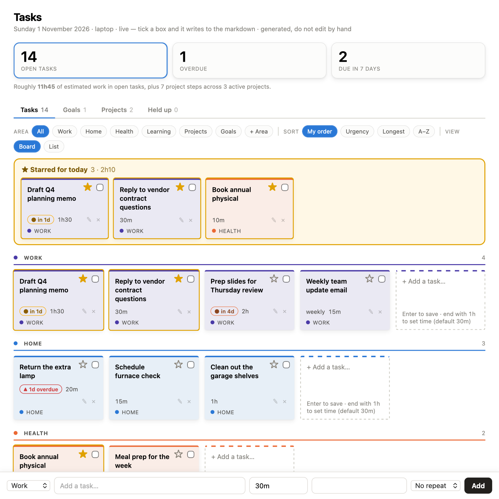
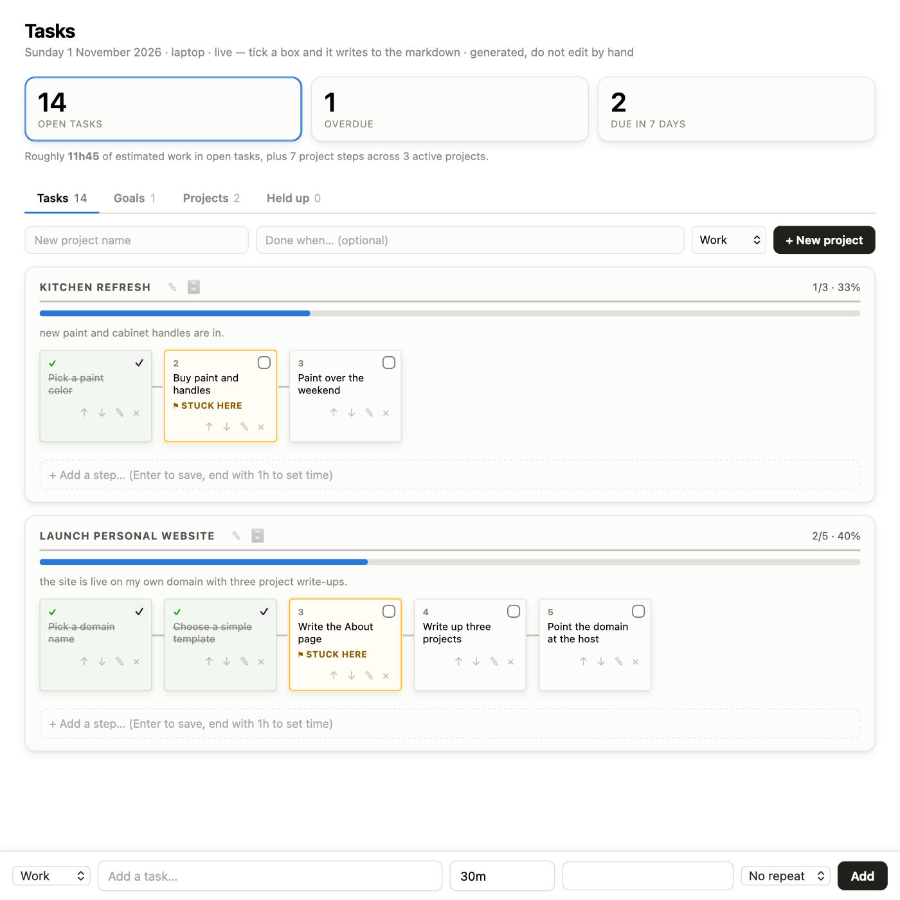

# Task Board

A local, single-user task dashboard that runs on plain markdown files. Your tasks live in
`tasks.md` and one file per project. The board reads them, and everything you click on the board
(add, tick off, star, edit, delete, drag, new project) is written straight back to those files.

No account, no database, no cloud, and no dependencies beyond Python 3.



## Why

Most task apps lock your list inside their own database. Here the list is a text file you own:
readable in any editor, easy to back up, and diffable in git. The dashboard is just a better
way to look at it and work with it.

## Quick start

```bash
git clone https://github.com/<your-username>/task-board.git
cd task-board
python3 server.py
```

Then open **http://127.0.0.1:8765**. The first run creates a blank board in `./data/` with one
example task to delete.

- Use a different folder for your data: `TASKBOARD_DATA=~/my-tasks python3 server.py`
- Use a different port: `TASKBOARD_PORT=9000 python3 server.py`
- The server listens on your own computer only (127.0.0.1). Nothing is exposed to the network.

## What you can do from the board

| | |
|---|---|
| **Add a task** | Type in the dashed box at the end of any lane and press Enter, or use the bar at the bottom (area, time estimate, due date, weekly repeat) |
| **Tick it off** | Checkbox. Ticked tasks move to a collapsible *Done* list, where you can untick them |
| **Star for today** | ☆ pins a task to the *Starred for today* row, with a running total of time. Stars expire at midnight on their own |
| **Edit** | ✎ to change the wording, time, due date or repeat |
| **Delete** | ✕ asks first, then keeps a copy in `data/archive/deleted-tasks.md` so nothing is lost |
| **Reorder or re-file** | Drag a task within a lane, or into another lane |
| **Areas** | *+ Area* adds a new lane |
| **Projects and goals** | Create one, add steps, reorder them with ↑ ↓, rename it, or archive it when it's done. Each project's next step also appears on the main board as *Project: step* |
| **Sort and filter** | By area, urgency, length or A–Z, as a board or a list |



## The file format

You never have to touch the files, but they're plain markdown if you want to.

**`data/tasks.md`**: each `## ` heading is an area (a lane). Each `- [ ]` line is a task.

```markdown
## Work
- [ ] Draft Q4 planning memo {1h30} {due 2026-12-01}
- [ ] Weekly team update email {15m} {every Fri}
- [x] Book conference room {10m}
```

| Tag | Meaning |
|---|---|
| `{30m}` `{1h}` `{1h30}` | time estimate |
| `{due 2026-12-01}` | due date (drives the overdue and due-soon flags) |
| `{every Fri}` | repeats weekly |
| `{star 2026-11-01}` | starred for that day only |
| `{ongoing}` or `{ongoing 3/12}` | a project step you chip away at, with optional progress |

**`data/projects/<name>.md`**: one file per project. Steps are the `- [ ]` lines under `## Steps`.
Add `kind: goal` to the header to make it a goal.

```markdown
---
project: Launch personal website
area: Learning
status: active
---

# Launch personal website

**Done when:** the site is live with three project write-ups.

## Steps
- [x] Pick a domain name {15m}
- [ ] Write the About page {1h}
```

## How it works

- `server.py` is a small server built on Python's standard library. It serves the page and
  handles each click by editing exactly one line of one file, matched by its full text, so a stale
  page can never overwrite the wrong task. It only ever writes inside the data folder.
- `board.py` reads the markdown and renders the page. It re-reads on every load, so edits made
  by hand in another editor show up on refresh.
- `python3 board.py` also writes a read-only `data/dashboard.html` you can open without the server.

## License

MIT. See [LICENSE](LICENSE).
